<p align="center">
  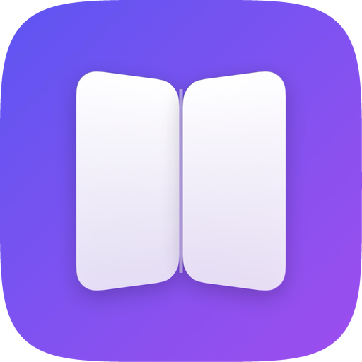
</p>

<h1 align="center">iPhone Duo by Examples</h1>

<p align="center">
  The SwiftUI APIs for the foldable <b>iPhone Duo</b>, one runnable example at a time.
</p>

<p align="center">
  
  
  
  
  <a href="LICENSE"></a>
</p>

<p align="center">
  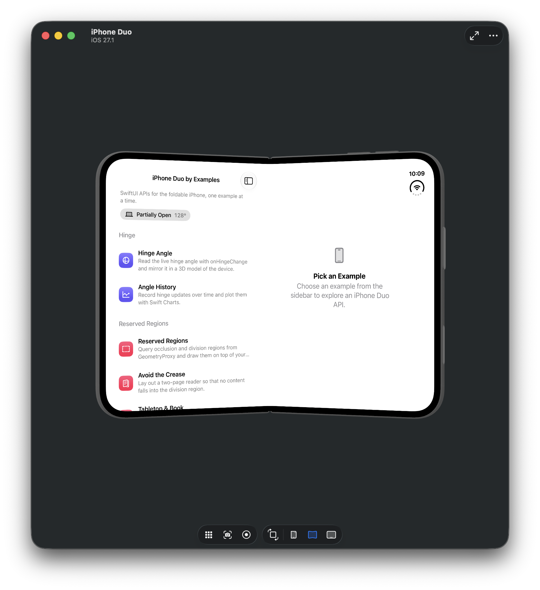
</p>

iOS 27.1 adds a set of SwiftUI APIs for the iPhone Duo: reading the hinge, finding the fold and the camera, arranging views side by side, controlling the new vertical bar, and showing content on the cover display. This project demonstrates each of them in a small example that you can run, read, and copy.

- Each example lives in **one file** in [`iPhoneDuoByExamples/Examples`](iPhoneDuoByExamples/Examples).
- Each file begins with a doc comment that explains the API.
- `// 👇 The API:` comments mark the lines that matter.

## Contents

- [Getting Started](#getting-started)
- [Examples](#examples)
- [API Cheat Sheet](#api-cheat-sheet)
- [API Index](#api-index)
- [Good to Know](#good-to-know)
- [Project Structure](#project-structure)
- [See Also](#see-also)
- [Resources](#resources)
- [Contributing](#contributing)
- [Author](#author)
- [License](#license)

## Getting Started

**Requirements:** Xcode 27.1 or later, and the iPhone Duo simulator (iOS 27.1) or an iPhone Duo.

```bash
git clone https://github.com/artemnovichkov/iPhone-Duo-by-Examples.git
cd iPhone-Duo-by-Examples
open iPhoneDuoByExamples.xcodeproj
```

Select the **iPhone Duo** run destination and press <kbd>⌘</kbd><kbd>R</kbd>. Fold and unfold the device in Simulator to watch the examples react.

> [!TIP]
> To open an example directly, pass its name as a launch argument. For example, `-example hingeAngle` or `-example avoidDivision`. The names are the cases of the [`Example`](iPhoneDuoByExamples/Catalog/Example.swift) enum.

## Examples

### Hinge

<table>
<tr>
<td width="50%" valign="top">
<p><a href="iPhoneDuoByExamples/Examples/HingeAngleExample.swift">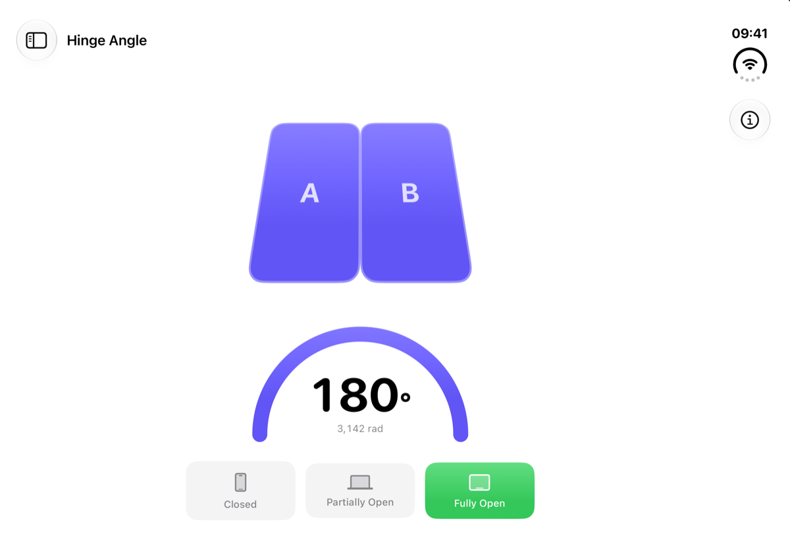</a></p>
<p><a href="iPhoneDuoByExamples/Examples/HingeAngleExample.swift"><b>Hinge Angle</b></a></p>
<p>Reads the live angle with <code>onHingeChange</code> and mirrors it in a 3D model of the device, a gauge, and a status strip.</p>
</td>
<td width="50%" valign="top">
<p><a href="iPhoneDuoByExamples/Examples/HingeHistoryExample.swift">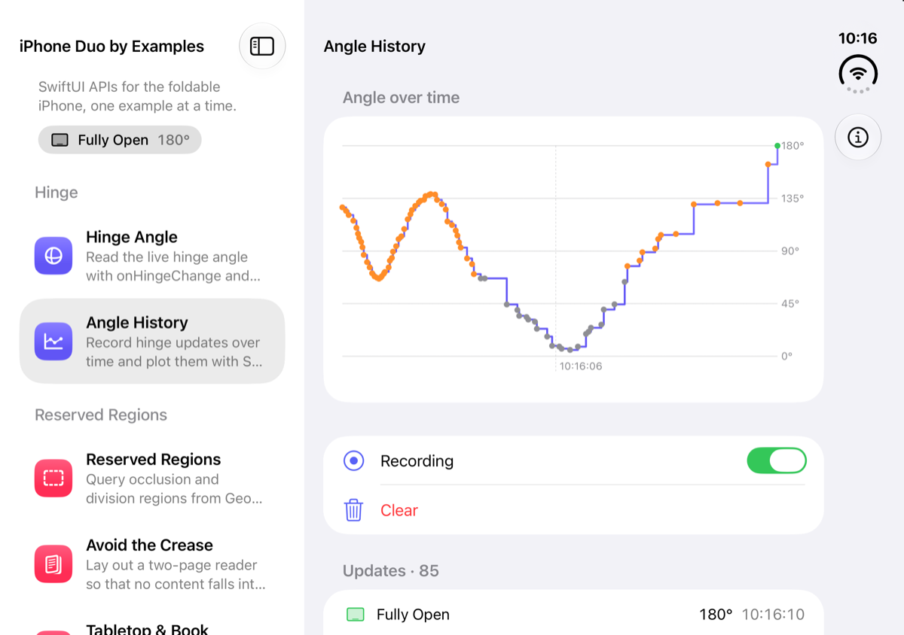</a></p>
<p><a href="iPhoneDuoByExamples/Examples/HingeHistoryExample.swift"><b>Angle History</b></a></p>
<p>Records every hinge update and plots it with Swift Charts. Uses <code>isEnabled</code> to pause delivery.</p>
</td>
</tr>
</table>

### Reserved Regions

<table>
<tr>
<td width="50%" valign="top">
<p><a href="iPhoneDuoByExamples/Examples/ReservedRegionsExample.swift">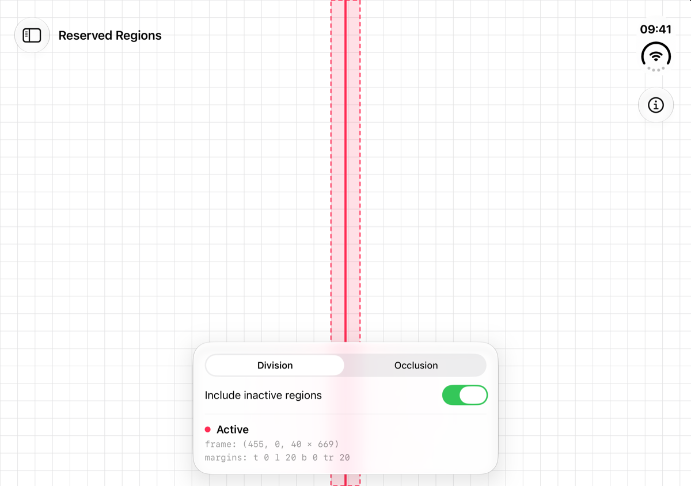</a></p>
<p><a href="iPhoneDuoByExamples/Examples/ReservedRegionsExample.swift"><b>Reserved Regions</b></a></p>
<p>Queries <code>.division</code> and <code>.occlusion</code> regions from <code>GeometryProxy</code> and draws each region's frame, margins, and active state.</p>
</td>
<td width="50%" valign="top">
<p><a href="iPhoneDuoByExamples/Examples/AvoidDivisionExample.swift">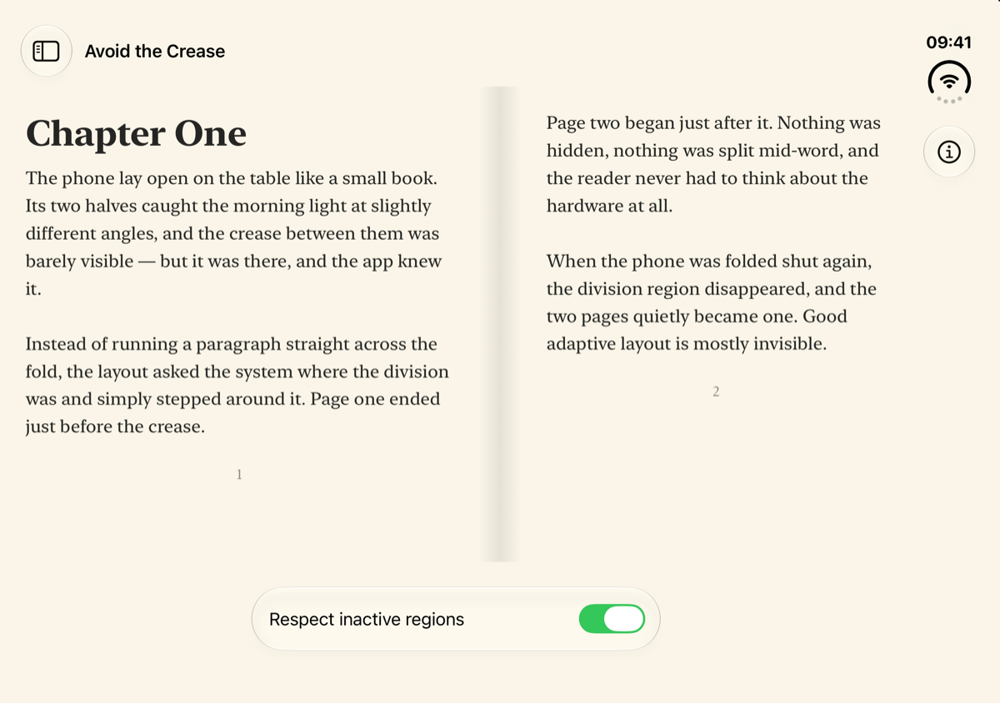</a></p>
<p><a href="iPhoneDuoByExamples/Examples/AvoidDivisionExample.swift"><b>Avoid the Crease</b></a></p>
<p>A two-page reader that places one page on each side of the division region. When there's no division, it falls back to one page.</p>
</td>
</tr>
<tr>
<td width="50%" valign="top">
<p><a href="iPhoneDuoByExamples/Examples/TabletopExample.swift">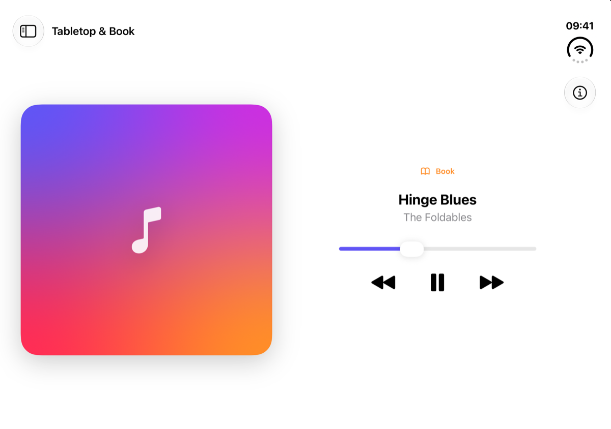</a></p>
<p><a href="iPhoneDuoByExamples/Examples/TabletopExample.swift"><b>Tabletop &amp; Book</b></a></p>
<p>Lays out a media player around the <i>active</i> division region: artwork above and controls below in tabletop pose, side by side in book pose. Apple recommends reserved regions, not the hinge angle, for layout.</p>
</td>
<td width="50%" valign="top">
<p><a href="iPhoneDuoByExamples/Examples/EvenColumnsExample.swift">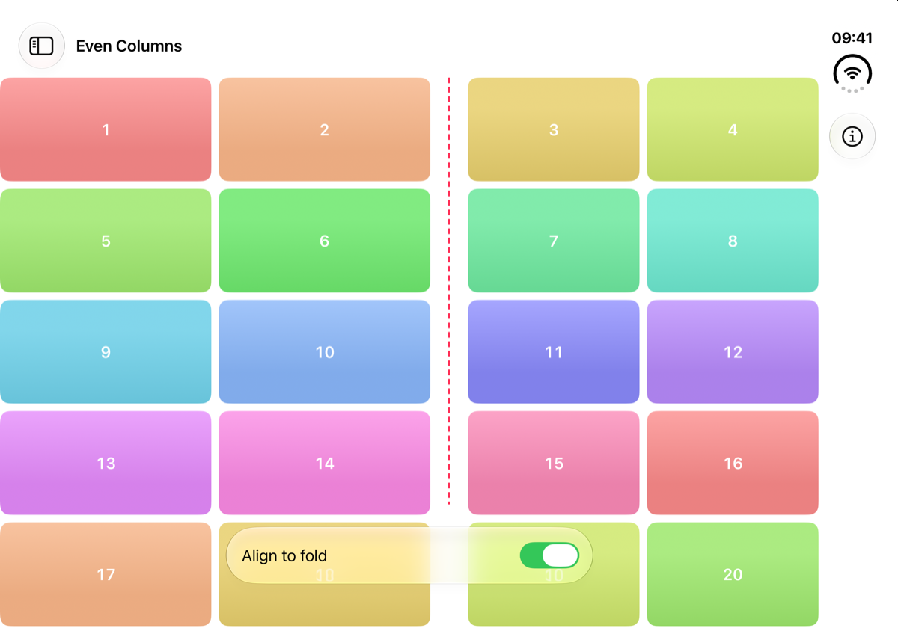</a></p>
<p><a href="iPhoneDuoByExamples/Examples/EvenColumnsExample.swift"><b>Even Columns</b></a></p>
<p>Uses the <i>inactive</i> division region to give a grid an even number of columns, with a gutter right over the fold.</p>
</td>
</tr>
</table>

### Arrangements

<table>
<tr>
<td width="50%" valign="top">
<p><a href="iPhoneDuoByExamples/Examples/SplitArrangementExample.swift">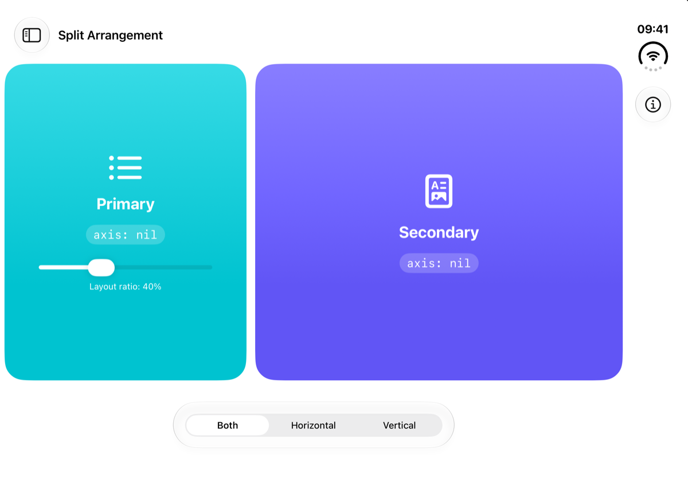 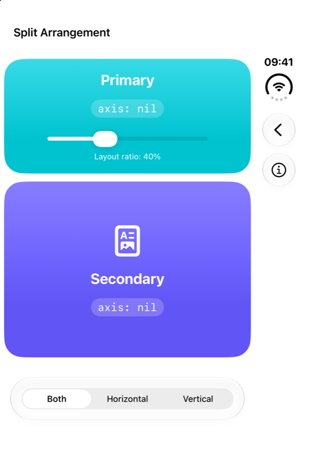</a></p>
<p><a href="iPhoneDuoByExamples/Examples/SplitArrangementExample.swift"><b>Split Arrangement</b></a></p>
<p><code>ArrangementView</code> with the <code>.split</code> style. Sets the allowed axes and the pane ratio with <code>splitArrangementLayoutRatio</code>. When unfolded, the panes sit side by side; when folded, they stack.</p>
</td>
<td width="50%" valign="top">
<p><a href="iPhoneDuoByExamples/Examples/OverlayArrangementExample.swift">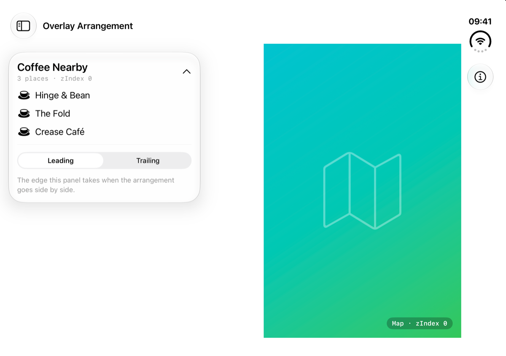</a></p>
<p><a href="iPhoneDuoByExamples/Examples/OverlayArrangementExample.swift"><b>Overlay Arrangement</b></a></p>
<p><code>ArrangementView</code> with the <code>.overlay</code> style: a results panel over a map. The panel collapses while <code>overlayArrangementZIndex</code> says it covers the map, and expands when the partially folded device puts the two side by side. <code>overlayArrangementEdge</code> sets which side the panel takes.</p>
</td>
</tr>
<tr>
<td width="50%" valign="top">
<p><a href="iPhoneDuoByExamples/Examples/DualPanePatternsExample.swift">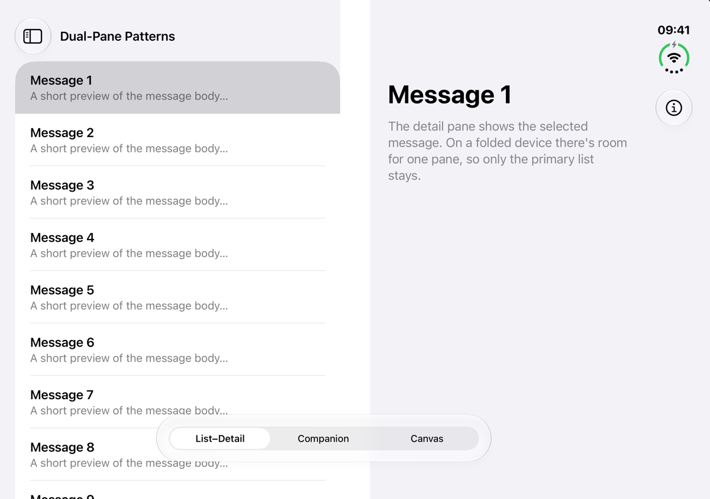</a></p>
<p><a href="iPhoneDuoByExamples/Examples/DualPanePatternsExample.swift"><b>Dual-Pane Patterns</b></a></p>
<p>List–detail, companion pane, and extended canvas, each built with <code>ArrangementView</code>. Covers <code>splitArrangementLayoutRatio(minHorizontal:idealHorizontal:)</code>, <code>splitArrangementLayoutSize</code>, <code>splitArrangementFixedLayoutSize</code>, and <code>.overlay.axes(_:)</code>.</p>
</td>
<td width="50%" valign="top">
<p><a href="iPhoneDuoByExamples/Examples/CustomArrangementExample.swift">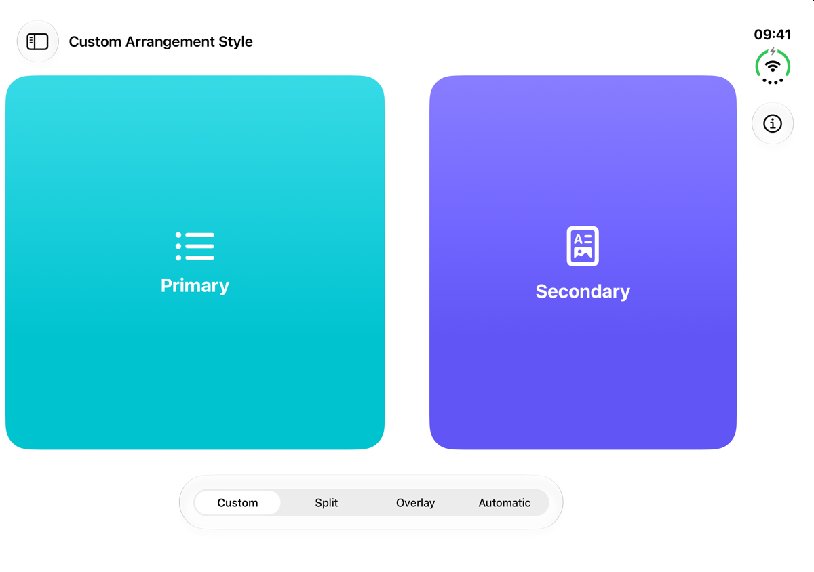 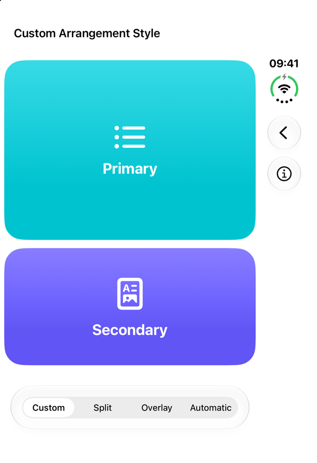</a></p>
<p><a href="iPhoneDuoByExamples/Examples/CustomArrangementExample.swift"><b>Custom Arrangement Style</b></a></p>
<p>A custom <code>ArrangementViewStyle</code> that reads the division region and gives each view its own side of the fold. Without a fold, it stacks them. Compare it with <code>.split</code>, <code>.overlay</code>, and <code>.automatic</code>.</p>
</td>
</tr>
</table>

### Bars & Margins

<table>
<tr>
<td width="50%" valign="top">
<p><a href="iPhoneDuoByExamples/Examples/VerticalToolbarExample.swift">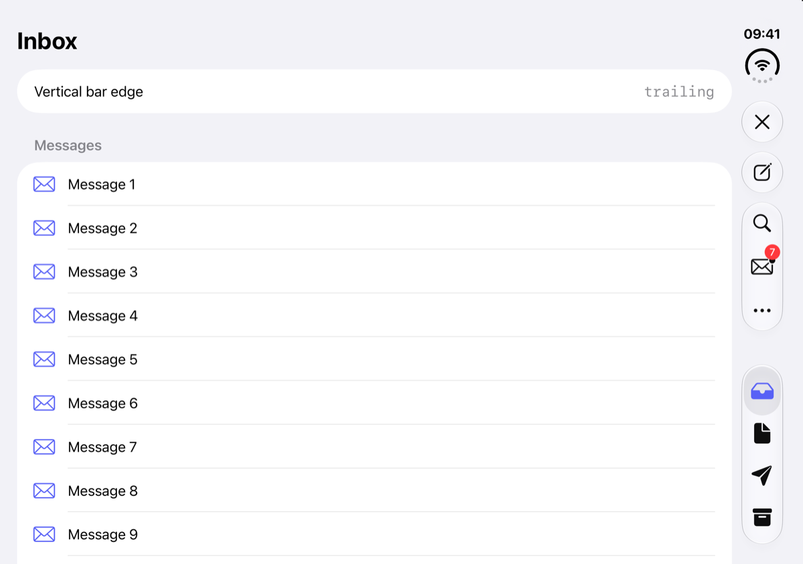</a></p>
<p><a href="iPhoneDuoByExamples/Examples/VerticalToolbarExample.swift"><b>Vertical Toolbar</b></a></p>
<p>A mail-style demo with a tab bar and toolbar items in the vertical bar. Covers <code>toolbarVerticalBehavior</code>, <code>toolbarVerticalCompressionBehavior</code>, <code>axisBehavior</code>, <code>visibilityPriority</code>, <code>.topBarPinnedTrailing</code>, <code>ToolbarOverflowMenu</code>, badges, and <code>toolbarVerticalEdge</code>.</p>
</td>
<td width="50%" valign="top">
<p><a href="iPhoneDuoByExamples/Examples/ContainerMarginsExample.swift">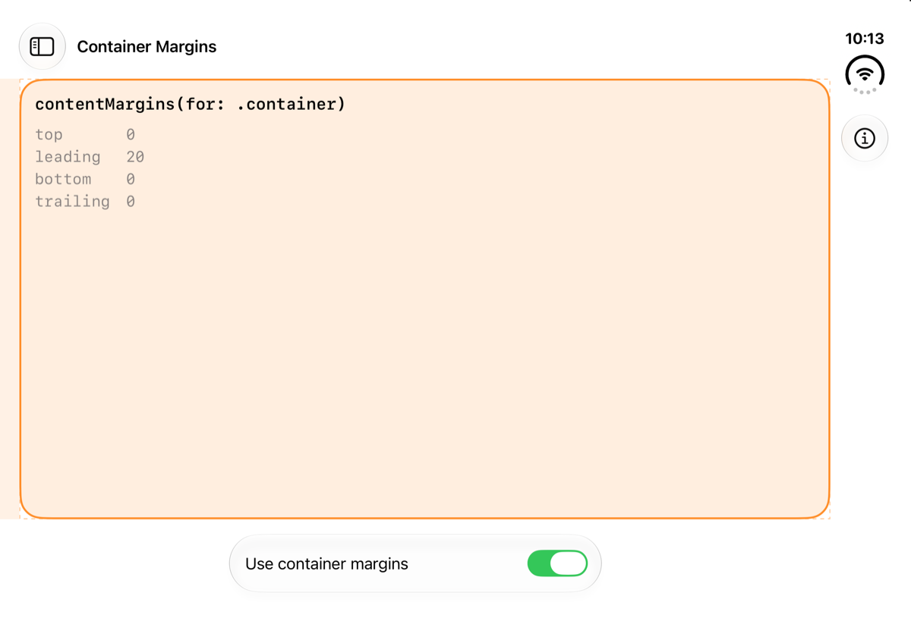</a></p>
<p><a href="iPhoneDuoByExamples/Examples/ContainerMarginsExample.swift"><b>Container Margins</b></a></p>
<p><code>contentMargins(for: .container)</code> compared with a hard-coded padding, and the raw values from <code>GeometryProxy.contentMargins(for:)</code>.</p>
</td>
</tr>
<tr>
<td width="50%" valign="top">
<p><a href="iPhoneDuoByExamples/Examples/ToolbarPriorityExample.swift">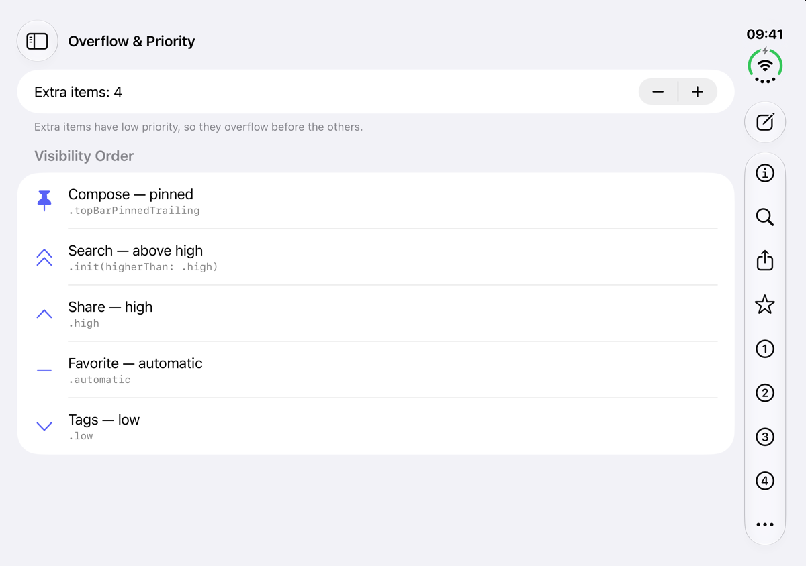</a></p>
<p><a href="iPhoneDuoByExamples/Examples/ToolbarPriorityExample.swift"><b>Overflow &amp; Priority</b></a></p>
<p>Add toolbar items with a stepper and watch them overflow, lowest priority first. Covers <code>.low</code>, <code>.high</code>, <code>ToolbarItemVisibilityPriority(higherThan:)</code>, <code>.topBarPinnedTrailing</code>, and <code>ToolbarOverflowMenu</code>.</p>
</td>
<td width="50%" valign="top">
</td>
</tr>
</table>

### Adaptivity

<table>
<tr>
<td width="50%" valign="top">
<p><a href="iPhoneDuoByExamples/Examples/FoldedUnfoldedExample.swift">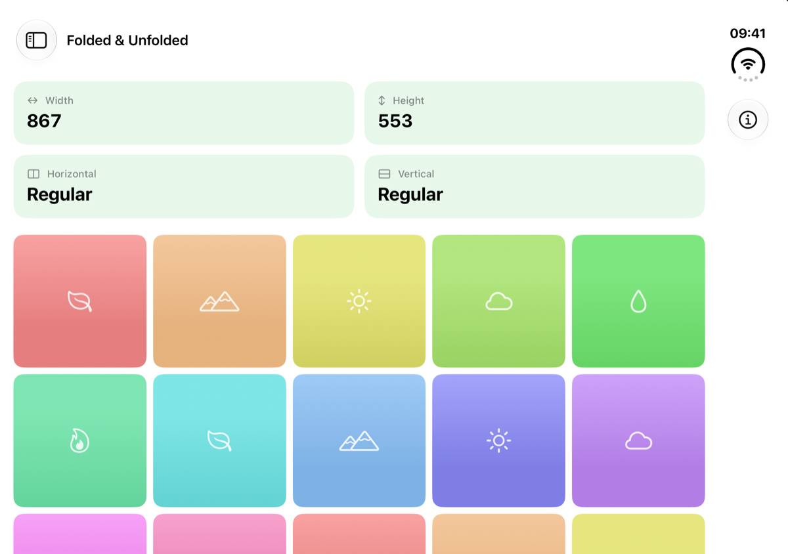 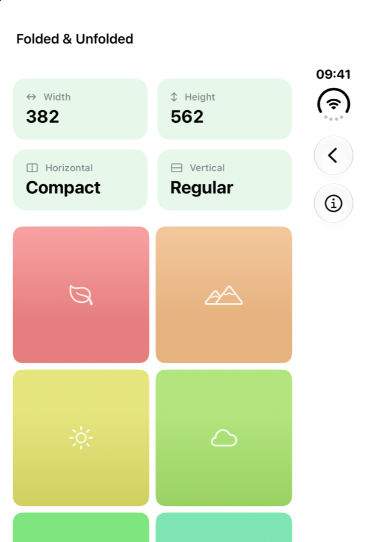</a></p>
<p><a href="iPhoneDuoByExamples/Examples/FoldedUnfoldedExample.swift"><b>Folded &amp; Unfolded</b></a></p>
<p>Adapts a layout to the space the app has, using size classes and <code>onGeometryChange</code>, rather than checking which device it runs on.</p>
</td>
<td width="50%" valign="top">
<p><a href="iPhoneDuoByExamples/Examples/SafeAreasExample.swift">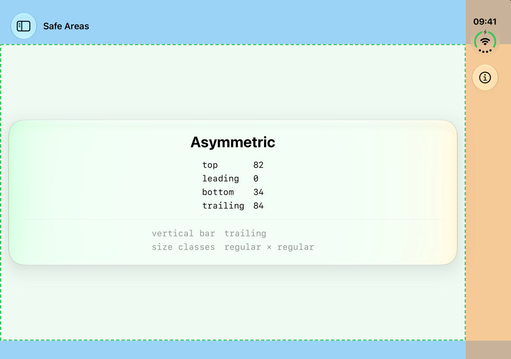 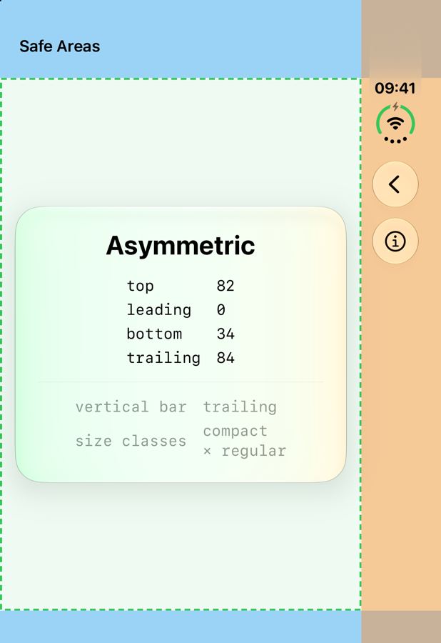</a></p>
<p><a href="iPhoneDuoByExamples/Examples/SafeAreasExample.swift"><b>Safe Areas</b></a></p>
<p>Draws the safe area insets on each edge. The vertical bar makes them asymmetric: wide on one side, zero on the other. <code>toolbarVerticalEdge</code> tells you which side the bar is on.</p>
</td>
</tr>
</table>

### Scenes & Displays

<table>
<tr>
<td width="50%" valign="top">
<p><a href="iPhoneDuoByExamples/Examples/SplitViewSideExample.swift">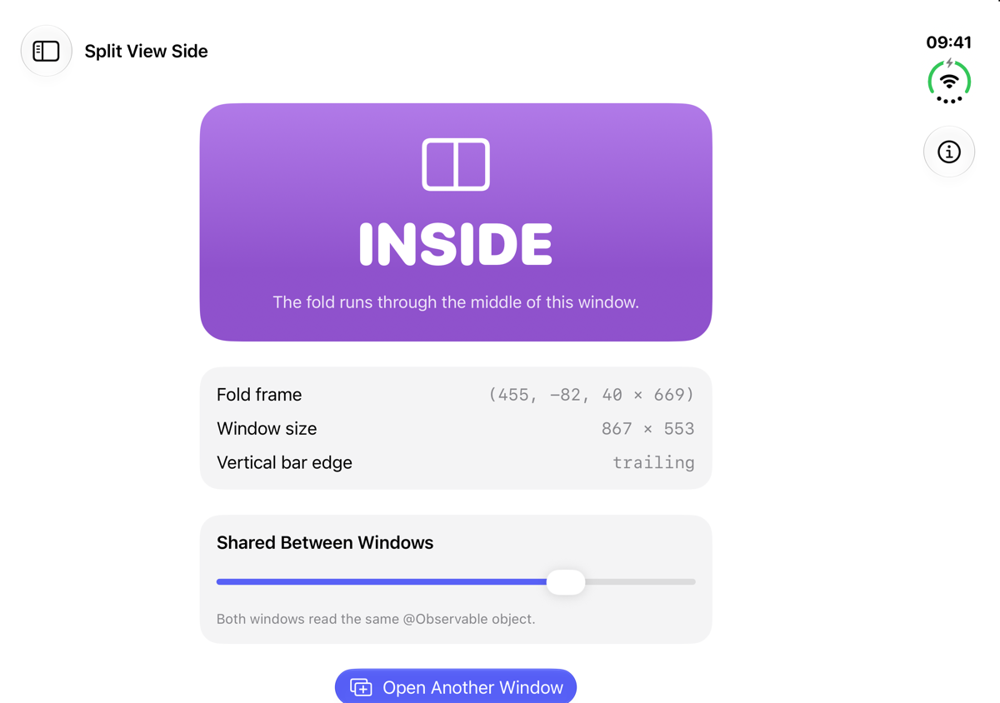 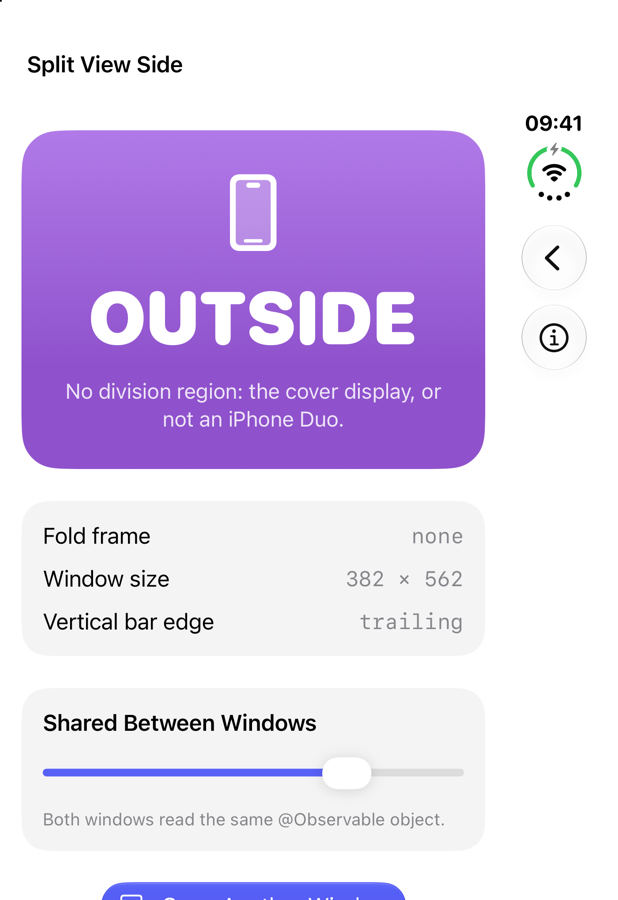</a></p>
<p><a href="iPhoneDuoByExamples/Examples/SplitViewSideExample.swift"><b>Split View Side</b></a></p>
<p>Works out whether a window is outside, inside, or on the left or right half of a Split View, from the inactive division region and <code>toolbarVerticalEdge</code>. Two windows share state through one <code>@Observable</code> object.</p>
</td>
<td width="50%" valign="top">
<p><a href="iPhoneDuoByExamples/Examples/CoverAccessoryExample.swift">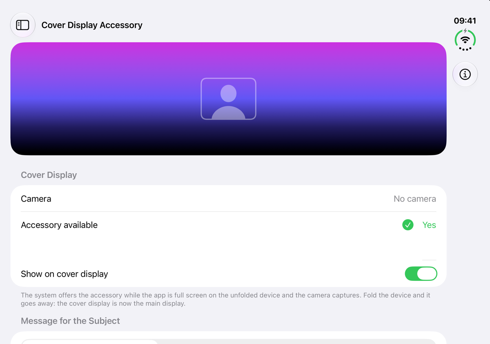 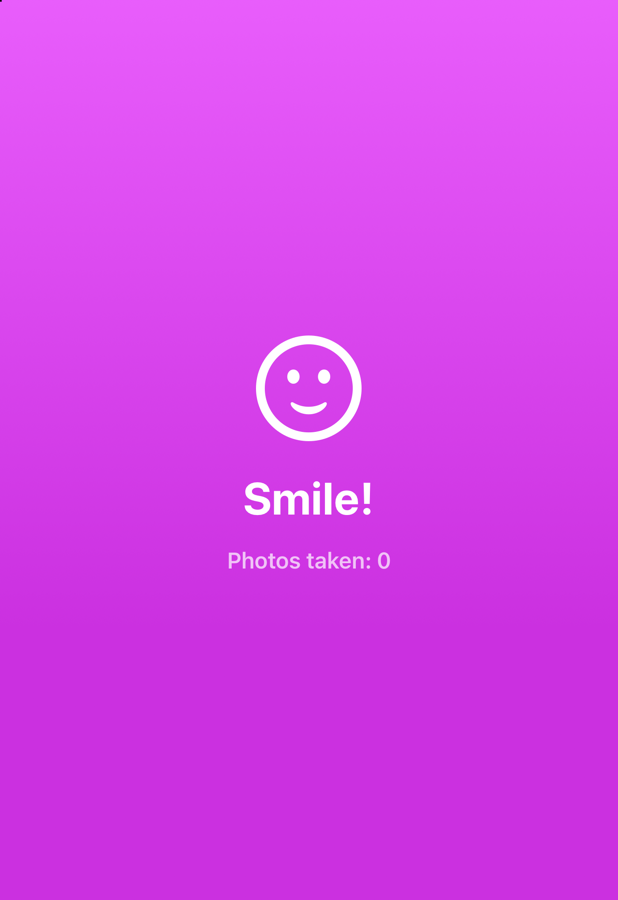</a></p>
<p><a href="iPhoneDuoByExamples/Examples/CoverAccessoryExample.swift"><b>Cover Display Accessory</b></a></p>
<p>While the camera runs on the inner display, <code>CameraCaptureAccessory</code> shows a second scene on the cover display, for the person being photographed. Uses <code>sceneAccessory</code> and <code>onAvailabilityChange</code>.</p>
</td>
</tr>
</table>

## API Cheat Sheet

### Hinge

```swift
@State private var hinge: DeviceHinge?

var body: some View {
    content
        .onHingeChange { oldContext, newContext in
            // `hinge` is nil when the view isn't in a hierarchy that provides hinge updates.
            hinge = newContext.hinge
        }
}

// hinge.angle   -> Angle (180° when the device is flat)
// hinge.status  -> .closed, .partiallyOpen, .fullyOpen
```

> [!IMPORTANT]
> Use the hinge for interactions and effects. For layout, use reserved regions and arrangements.

`onHingeChange(isEnabled:_:)` runs its action with the initial state and again on every change. To pause updates without removing the modifier, pass `isEnabled: false`.

### Reserved regions

```swift
GeometryReader { proxy in
    let folds = proxy.reservedRegions(kind: .division)
    let cutouts = proxy.reservedRegions(kind: .occlusion, options: [.includeInactive])

    ForEach(folds) { region in
        // region.frame     — in the proxy's coordinate space, margins included
        // region.margins   — room to keep clear around the reserved rect
        // region.isActive  — whether it currently affects your layout
    }
}
```

The division region is active only while the device is partially folded. Lay out around active regions. Use inactive ones for high-level decisions, such as an even number of grid columns.

### Arrangements

```swift
ArrangementView {
    Sidebar()
        .splitArrangementLayoutRatio(0.4)
} secondary: {
    Detail()
}
.arrangementViewStyle(.split.axes([.horizontal, .vertical]))
```

```swift
ArrangementView {
    FloatingPanel()                          // floats on top
        .overlayArrangementEdge(.leading)    // its edge when the layout goes side by side
} secondary: {
    Map()                                    // fills the container
}
.arrangementViewStyle(.overlay)

struct PanelContent: View {                  // a subview of FloatingPanel
    @Environment(\.overlayArrangementZIndex) private var zIndex
    // zIndex > 0 -> floating over the map: collapse
}
```

Other modifiers: `splitArrangementLayoutRatio(minHorizontal:idealHorizontal:…)`, `splitArrangementLayoutSize(minWidth:…)`, and `splitArrangementFixedLayoutSize(horizontal:vertical:)`.

```swift
struct FoldArrangementStyle: ArrangementViewStyle {
    func makeBody(configuration: Configuration) -> some View {
        GeometryReader { proxy in                    // a style reads the fold itself
            let fold = proxy.reservedRegions(kind: .division, options: [.includeInactive]).first
            // place configuration.primary and configuration.secondary around `fold`
        }
    }
}

ArrangementView { … } secondary: { … }
    .arrangementViewStyle(FoldArrangementStyle())
```

### Vertical bar

```swift
TabView { … }
    .toolbarVerticalBehavior(.disabled)                     // opt out, e.g. for a video player

NavigationStack { … }
    .toolbar {
        ToolbarItem(placement: .topBarPinnedTrailing) { … }  // never overflows
        ToolbarItem(placement: .primaryAction) { … }
            .axisBehavior(.verticalPreferred)               // or .horizontalOnly
            .visibilityPriority(.high)
        ToolbarOverflowMenu { … }                           // straight into the overflow menu
    }
    .toolbarVerticalCompressionBehavior(.prefersTabBar)     // or .prefersToolbarItems

@Environment(\.toolbarVerticalEdge) private var edge        // .leading, .trailing, or nil

ToolbarItem { … }
    .visibilityPriority(.init(higherThan: .high))           // .low < .automatic < .high
```

### Container margins

```swift
content
    .contentMargins(for: .container)

GeometryReader { proxy in
    let margins = proxy.contentMargins(for: .container)
}
```

### Cover display

```swift
CameraView()
    .sceneAccessory {
        CameraCaptureAccessory(isEnabled: $showsOnCover) {
            SubjectView()                                   // a separate scene, same process
        }
        .onAvailabilityChange { isAvailable in … }
    }
```

For non-interactive content on an external display, use `ExternalNonInteractiveAccessory` the same way.

## API Index

| API | Examples |
| --- | --- |
| `onHingeChange(isEnabled:_:)`, `DeviceHinge` | [Hinge Angle](iPhoneDuoByExamples/Examples/HingeAngleExample.swift), [Angle History](iPhoneDuoByExamples/Examples/HingeHistoryExample.swift) |
| `GeometryProxy.reservedRegions(kind:options:layoutDirectionBehavior:)` | [Reserved Regions](iPhoneDuoByExamples/Examples/ReservedRegionsExample.swift), [Avoid the Crease](iPhoneDuoByExamples/Examples/AvoidDivisionExample.swift), [Tabletop & Book](iPhoneDuoByExamples/Examples/TabletopExample.swift), [Even Columns](iPhoneDuoByExamples/Examples/EvenColumnsExample.swift), [Custom Arrangement Style](iPhoneDuoByExamples/Examples/CustomArrangementExample.swift), [Split View Side](iPhoneDuoByExamples/Examples/SplitViewSideExample.swift) |
| `ArrangementView`, `.split`, `splitArrangementLayoutRatio`, `splitArrangementAxis` | [Split Arrangement](iPhoneDuoByExamples/Examples/SplitArrangementExample.swift), [Dual-Pane Patterns](iPhoneDuoByExamples/Examples/DualPanePatternsExample.swift) |
| `splitArrangementLayoutSize`, `splitArrangementFixedLayoutSize` | [Dual-Pane Patterns](iPhoneDuoByExamples/Examples/DualPanePatternsExample.swift) |
| `.overlay`, `overlayArrangementEdge`, `overlayArrangementZIndex` | [Overlay Arrangement](iPhoneDuoByExamples/Examples/OverlayArrangementExample.swift), [Dual-Pane Patterns](iPhoneDuoByExamples/Examples/DualPanePatternsExample.swift) |
| `ArrangementViewStyle`, `.automatic` | [Custom Arrangement Style](iPhoneDuoByExamples/Examples/CustomArrangementExample.swift) |
| `toolbarVerticalBehavior`, `toolbarVerticalCompressionBehavior`, `axisBehavior` | [Vertical Toolbar](iPhoneDuoByExamples/Examples/VerticalToolbarExample.swift) |
| `visibilityPriority`, `ToolbarItemVisibilityPriority`, `.topBarPinnedTrailing`, `ToolbarOverflowMenu` | [Vertical Toolbar](iPhoneDuoByExamples/Examples/VerticalToolbarExample.swift), [Overflow & Priority](iPhoneDuoByExamples/Examples/ToolbarPriorityExample.swift) |
| `toolbarVerticalEdge` | [Vertical Toolbar](iPhoneDuoByExamples/Examples/VerticalToolbarExample.swift), [Safe Areas](iPhoneDuoByExamples/Examples/SafeAreasExample.swift), [Split View Side](iPhoneDuoByExamples/Examples/SplitViewSideExample.swift) |
| `contentMargins(for:)`, `ContentMarginGuide.container` | [Container Margins](iPhoneDuoByExamples/Examples/ContainerMarginsExample.swift) |
| `sceneAccessory`, `CameraCaptureAccessory`, `onAvailabilityChange` | [Cover Display Accessory](iPhoneDuoByExamples/Examples/CoverAccessoryExample.swift) |

## Good to Know

These are observations from the iPhone Duo simulator on iOS 27.1. They aren't documented guarantees.

- **The division region is active only when the device is partially folded.** When flat, it's inactive. Its frame is the same in both states: 40 pt wide, with 20 pt margins on each side of a zero-width fold line.
- **Reserved regions arrive after the first layout pass.** Read them in the `GeometryReader` body so the view updates when they arrive. Don't cache them.
- **Most regions are inactive by default.** On a fully open device, the fold is reported as an *inactive* division region, and the camera is an inactive occlusion region. To see them, pass `.includeInactive`.
- **The status bar area of the vertical bar is an active occlusion region.**
- **When folded, the outer display has no reserved regions at all**, not even inactive ones. The outer display is compact width and regular height, and it also has a vertical bar on the trailing edge.
- **In the `.overlay` style, the _primary_ view floats** in the top leading corner, and the _secondary_ view fills the space behind it. When the device is partially folded, the two go side by side.
- **Read `overlayArrangementZIndex` from a subview** of the primary or secondary content. The root view of the content always reads `0`.
- **Arrangements follow the fold.** In book pose, `.split` places its divider on the fold, even if that overrides `splitArrangementLayoutRatio`.
- **In the `.split` style, the secondary view can disappear.** If both views don't fit along an allowed axis, only the primary view is shown. For example, this happens with `.split.axes(.vertical)` on a wide screen.
- **`splitArrangementAxis` was `nil`** in every configuration tested in the simulator.
- **Avoid `maxHorizontal` in `splitArrangementLayoutRatio`.** With a maximum, the divider doesn't move to the fold in book pose, and the secondary view is squeezed into a narrow column. A single ratio, or `minHorizontal` with `idealHorizontal`, follows the fold.
- **`splitArrangementFixedLayoutSize` wins over the fold.** A pane with a fixed width keeps it in book pose, so the divider isn't on the fold.
- **Don't depend on the timing of hinge angle updates.** Their rate and precision are system policy. If you only need the posture, use `status`.
- **The vertical bar configuration flows up** to the window or the nearest presentation. That's why the Vertical Toolbar demo is presented full screen.
- **The vertical bar fits fewer items on the cover display.** With the same toolbar, the inner display in landscape shows more items before the overflow menu. Lower `visibilityPriority` items overflow first.
- **The vertical bar makes the safe area asymmetric.** With the bar on the trailing edge, the trailing inset is 84 pt and the leading inset is 0, on both displays.
- **The simulator offers `CameraCaptureAccessory` without a running capture session**, so you can try the cover display there. Folded, the accessory isn't available.
- **On iPhone, `openWindow` opens the new window full screen**, not in Split View. To put two windows side by side, use Split View.

## Project Structure

```
iPhoneDuoByExamples
├── App           # App entry point
├── Catalog       # Example list, info sheet, metadata
├── Components    # Shared views and DeviceHinge helpers
├── Examples      # One file per example ← start here
└── Resources     # Asset catalog
```

Examples that need app-level setup, like a second window or the camera usage description, use [`iPhoneDuoByExamplesApp.swift`](iPhoneDuoByExamples/App/iPhoneDuoByExamplesApp.swift) and the build settings in the project file.

The Xcode project uses Xcode's JSON project format ([`project.xcproj`](iPhoneDuoByExamples.xcodeproj/project.xcproj)). It's readable and easy to edit by hand; each source file is listed there with its target membership.

## See Also

Apps and games built for iPhone Duo, where folding the device is the whole point.

<table>
<tr>
<td width="80"><a href="https://github.com/artemnovichkov/Accorduon"></a></td>
<td><a href="https://github.com/artemnovichkov/Accorduon"><b>Accorduon</b></a><br>An accordion where the hinge is the bellows. Fold and unfold to play.</td>
</tr>
<tr>
<td width="80"><a href="https://github.com/artemnovichkov/SandValley"></a></td>
<td><a href="https://github.com/artemnovichkov/SandValley"><b>SandValley</b></a><br>Pour sand on the screen and fold the device to make it slide into the valley.</td>
</tr>
<tr>
<td width="80"><a href="https://github.com/artemnovichkov/Duogami"></a></td>
<td><a href="https://github.com/artemnovichkov/Duogami"><b>Duogami</b></a><br>An origami workshop. Fold the phone to fold the paper, one crease at a time.</td>
</tr>
<tr>
<td width="80"><a href="https://github.com/artemnovichkov/ClawKit"></a></td>
<td><a href="https://github.com/artemnovichkov/ClawKit"><b>ClawKit</b></a><br>A clay claw machine. The cabinet stands above the fold, the controls sit below it.</td>
</tr>
<tr>
<td width="80"><a href="https://github.com/artemnovichkov/DuoBird"></a></td>
<td><a href="https://github.com/artemnovichkov/DuoBird"><b>DuoBird</b></a><br>Flappy Bird played with the hinge. Snap the device open to flap through the pipes.</td>
</tr>
<tr>
<td width="80"><a href="https://github.com/artemnovichkov/DuoCut"></a></td>
<td><a href="https://github.com/artemnovichkov/DuoCut"><b>DuoCut</b></a><br>The fold is a blade. Slide shapes under it and cut them in half.</td>
</tr>
</table>

## Resources

- [Get Ready for iPhone Duo](https://developer.apple.com/iphone-duo/)
- [Preparing your app for iPhone Duo](https://developer.apple.com/documentation/technologyoverviews/preparing-your-app-for-iphone-duo)
- [Designing for iPhone Duo](https://developer.apple.com/design/human-interface-guidelines/designing-for-iphone-duo) in the Human Interface Guidelines
- Tech Talks:
  - [Prepare your app for iPhone Duo](https://developer.apple.com/videos/play/tech-talks/111461/)
  - [Raise the bar with iPhone Duo](https://developer.apple.com/videos/play/tech-talks/111462/)
  - [Strike a pose with adaptive layouts on iPhone Duo](https://developer.apple.com/videos/play/tech-talks/111463/)
  - [Leverage multiple displays and scenes on iPhone Duo](https://developer.apple.com/videos/play/tech-talks/111464/)
  - [Design for iPhone Duo](https://developer.apple.com/videos/play/tech-talks/111466/)

## Contributing

Found a new API, or a better way to use one? Issues and pull requests are welcome. Please keep each example in a single file and focused on one idea.

## Author

Artem Novichkov, https://artemnovichkov.com/

## License

The project is available under the MIT license. See the [LICENSE](./LICENSE) file for more info.
